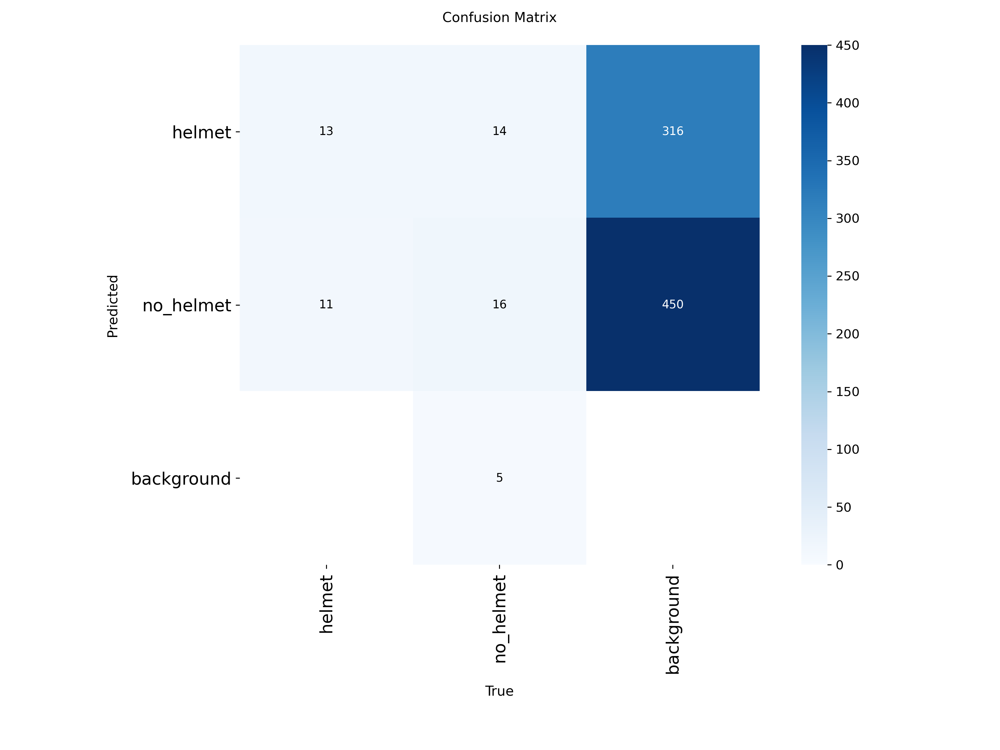
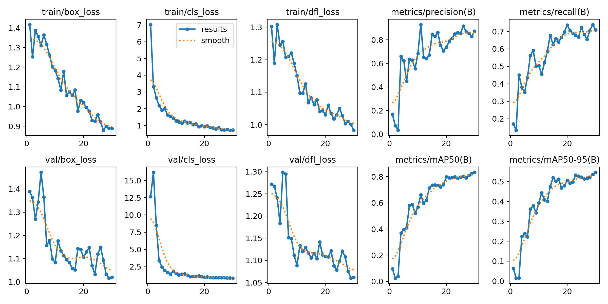

# Helmet Detection using YOLOv8n

Detects whether a motorcycle rider is wearing a helmet (`helmet`) or not (`no_helmet`).
Built for the AIRI Team PITB AI Internship, Task 1.

## Problem
Riding without a helmet is a major cause of fatal injuries on Pakistani roads. This project trains an object detection model for automated road-safety or site-safety monitoring.

## Dataset
- 236 images: 172 train / 43 val / 21 test
- Sources: 50 self-collected photos (laptop and phone) + 186 public images from GitHub
- Annotated in Roboflow: 32 images fully manually, the rest with Roboflow AI-assisted labeling
- Classes: `helmet`, `no_helmet`
- Format: YOLO (see `dataset/data.yaml`)

## Model and Training
| Setting | Value |
|---|---|
| Model | YOLOv8n (pretrained) |
| Epochs | 30 |
| Image size | 640 |
| Batch size | 8 |
| Hardware | Google Colab, Tesla T4 |
| Training time | 2.2 minutes |

## Results
| Split | Precision | Recall | mAP@0.5 | mAP@0.5:0.95 |
|---|---|---|---|---|
| Validation (43 images) | 0.877 | 0.705 | 0.826 | 0.542 |
| Test (21 images) | 0.971 | 0.701 | 0.927 | 0.701 |

Tested on 18 unseen night-time images: about 12 correct, 5 missed (mostly dark full-face helmets), 1 wrong class.

## Error Analysis (summary)
- Dark full-face helmets were missed in low light.
- One no-helmet rider was predicted as helmet (night, similar outline).
- Very low confidence on several correct detections; small dataset.
- Fixes: more dark helmet and low-light images, longer training, higher confidence threshold, brightness augmentation.

## Demo
A Gradio demo is included in the notebook: upload an image and get helmet / no_helmet detections with confidence scores. Screenshots are in `outputs/demo_results/`.

## How to Run
~~~bash
pip install -r requirements.txt
~~~
~~~python
from ultralytics import YOLO
model = YOLO("models/best.pt")
model.predict("your_image.jpg", conf=0.35, save=True)
~~~

## Project Structure
~~~
cv_project/
  dataset/ (images, labels, data.yaml)
  notebooks/training_notebook.ipynb
  outputs/ (training_results, predictions, demo_results)
  models/best.pt
  report/final_report.pdf
  README.md
  requirements.txt
~~~

## Limitations
Small dataset, small test set, unseen images from one location at night.

## Future Work
More diverse data, longer training, YOLOv8s, add person class and number-plate detection.

Author: Muhammad Talha Farooq
